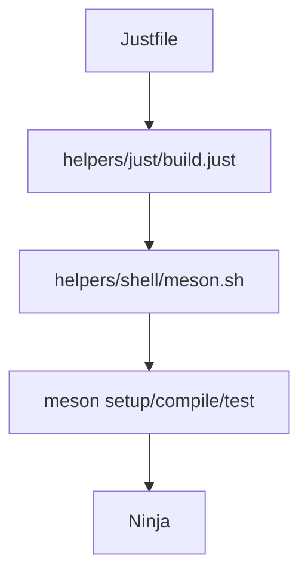

# Regla 18: Soporte Beta para Meson


### Premisa: Premisa

Meson se introduce como **alternativa beta** al Makefile en la capa de construcción, manteniendo intactas las otras dos capas: **Justfile** (task manager) y **helpers** (lógica real). Meson declara la construcción de forma descriptiva (`meson.build`) y delega la ejecución en **Ninja**; el Justfile sigue orquestando operativas y los helpers siguen siendo la fuente única de ejecución.

> **Nota:** esta regla describe el soporte **beta** de Meson para **proyectos consumidores**. No es el sistema por defecto — el Makefile de la [Regla 01](01-build-tooling.md) sigue siendo el estándar. Meson se activa de forma explícita por proyecto, sin alterar el rol del Justfile ni la capa de helpers.

tags: [obligatorio]

### Restriccion: Restricciones

- **No mezclar** Makefile y Meson en la misma capa de construcción: un proyecto elige uno u otro (el estándar Makefile o el beta Meson). El Justfile y los helpers permanecen igual.
- **No convertir Meson en el sistema por defecto** sin decisión explícita: sigue siendo beta hasta estabilizarse en los proyectos consumidores.
- **No reemplazar el Justfile** por `meson`/`ninja run`: Meson cubre setup/build/test/install; las operativas de día a día siguen en Just.
- **No incrustar lógica de negocio** en `meson.build`: solo describe proyecto, fuentes, dependencias y opciones. La lógica real vive en los helpers.
- **No trackear el directorio de build** (`builddir/`, `build/`): se regenera con `meson setup` y debe excluirse en el `.gitignore`.

tags: [obligatorio]

### Estructura: Estructura

```
proyecto/
├── meson.build              # Declaración de build (beta, alterna con Makefile)
├── meson_options.txt        # Opciones de configuración (opcional)
├── subprojects/             # Dependencias wrap (opcional)
├── Justfile                 # Task manager (sin cambios)
├── helpers/
│   ├── just/
│   │   └── build.just       # operativas que envuelven meson
│   └── shell/
│       └── meson.sh         # wrapper: setup/compile/test/install
└── src/
```

**Flujo de delegación (beta Meson):**

```
Justfile ──→ helpers/just/build.just ──→ helpers/shell/meson.sh ──→ meson/ninja
```

**Principio de capa única de ejecución:** los helpers (`helpers/shell/`) siguen siendo la fuente única de lógica. Meson reemplaza únicamente el papel del Makefile como declaración de construcción; el Justfile orquesta y delega en los mismos helpers.

tags: [opcional]

### Comando: Comandos

### Ciclo básico (Meson + Ninja)

```bash
meson setup builddir        # Configurar el build
meson compile -C builddir   # Compilar (invoca Ninja)
meson test -C builddir      # Ejecutar tests
meson install -C builddir   # Instalar
```

### Vía Justfile (orquestación)

```bash
just setup                  # → helpers/shell/meson.sh --goal setup
just build                  # → helpers/shell/meson.sh --goal compile
just test                   # → helpers/shell/meson.sh --goal test
```

### Ejecución del helper con flags

```bash
bash helpers/shell/meson.sh --goal compile --builddir builddir --log-file /var/log/proyecto/log-meson-20260820T120000Z.log
```

tags: [obligatorio]

### Ejemplo: Ejemplos

### meson.build mínimo

```meson
project('app', 'c', version: '0.1.0', default_options: ['warning_level=3'])

app_src = files('src/main.c')
executable('app', app_src, install: true)
```

### meson_options.txt

```
# `buildtype` es una opción integrada de Meson; solo se declaran opciones del proyecto.
option('enable_tests', type: 'boolean', value: true)
```

### Justfile (recetas que envuelven Meson)

```just
import 'helpers/just/build.just'

@setup:
    bash helpers/shell/meson.sh --goal setup

@build:
    bash helpers/shell/meson.sh --goal compile

@test:
    bash helpers/shell/meson.sh --goal test
```

tags: [obligatorio]

### Diagrama: Flujo de delegación (Meson beta)



tags: [opcional]

### Matriz: Capa de construcción por sistema

| Capa | Estándar (regla 01) | Beta (esta regla) |
|------|--------------------|-------------------|
| Construcción | Makefile + helpers/mk/*.mk | meson.build + meson.sh |
| Task manager | Justfile | Justfile (sin cambios) |
| Ejecución | helpers/shell/*.sh | helpers/shell/*.sh |

tags: [opcional]

### Referencia: Referencias

- [Regla 01: Build Tooling](01-build-tooling.md) — sistema de construcción estándar (Makefile + Justfile + helpers)
- [Regla 08: Stack Tecnológico](08-stack.md)
- [templates/repository-structure/Justfile.tmpl](https://github.com/rafex/ether-my-best-practice/blob/main/templates/repository-structure/Justfile.tmpl)
- [templates/repository-structure/Makefile.tmpl](https://github.com/rafex/ether-my-best-practice/blob/main/templates/repository-structure/Makefile.tmpl)
- [templates/repository-structure/meson.build.tmpl](https://github.com/rafex/ether-my-best-practice/blob/main/templates/repository-structure/meson.build.tmpl)
- [templates/repository-structure/meson_options.txt.tmpl](https://github.com/rafex/ether-my-best-practice/blob/main/templates/repository-structure/meson_options.txt.tmpl)
- [templates/repository-structure/helpers/just/build.just.tmpl](https://github.com/rafex/ether-my-best-practice/blob/main/templates/repository-structure/helpers/just/build.just.tmpl)
- [templates/repository-structure/helpers/shell/meson.sh.tmpl](https://github.com/rafex/ether-my-best-practice/blob/main/templates/repository-structure/helpers/shell/meson.sh.tmpl)

tags: [obligatorio]
